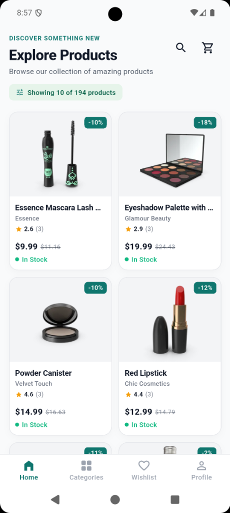
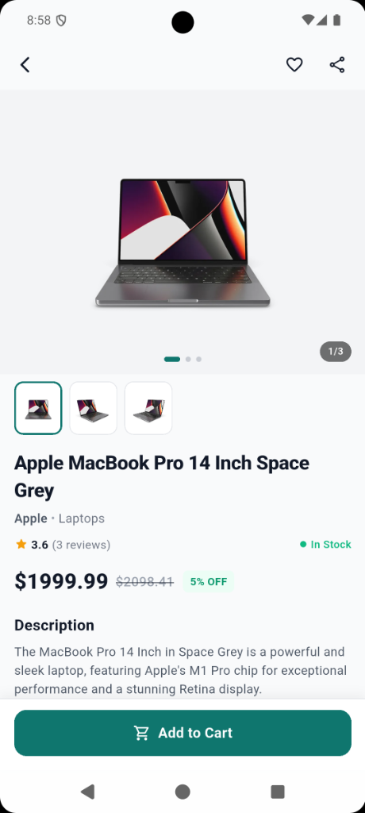

<p align="center">
  
</p>

<h1 align="center">Productly — Flutter Product Explorer</h1>

<p align="center">
  A clean, production-ready product exploration application built with <b>Clean Architecture</b>, <b>BLoC</b>, <b>Injectable & GetIt</b>, and <b>GoRouter</b>.
</p>

<p align="center">
  <a href="https://drive.google.com/file/d/13pxKsgXAI2xKS7sItUtd8DDm1PxDUSeU/view?usp=sharing">
    
  </a>
  &nbsp;&nbsp;
  <a href="https://drive.google.com/file/d/17C8F2OUYZc5Cb9ZAfJ5yNytR3zFyp1-U/view?usp=sharing">
    
  </a>
</p>

---

## 🔗 Quick Links

- 📦 **Android APK:** [Download from Google Drive](https://drive.google.com/file/d/13pxKsgXAI2xKS7sItUtd8DDm1PxDUSeU/view?usp=sharing)
- 🎬 **Demo Video:** [Watch on Google Drive](https://drive.google.com/file/d/17C8F2OUYZc5Cb9ZAfJ5yNytR3zFyp1-U/view?usp=sharing)

---

## 📱 Screenshots

<p align="center">
  
  &nbsp;&nbsp;&nbsp;&nbsp;&nbsp;&nbsp;&nbsp;&nbsp;
  
</p>

<p align="center">
  <i>Product List (Infinite Pagination & 2-Column Grid) &nbsp;•&nbsp; Product Details (Gallery, Specs, Reviews & Policies)</i>
</p>

---

## ✨ Features

- **Splash Screen:** Minimal branding, custom shopping bag logo, tagline, and auto-transition to products.
- **Product List Screen:**
  - 2-column responsive grid with cached thumbnails, discount badges, ratings, stock status, and price comparison.
  - Infinite scroll pagination (`skip=0, 10, 20...`) with duplicate request prevention.
  - Pull-to-refresh to reset pagination and reload data.
  - Loading shimmers, full-screen error states, and pagination retry controls.
- **Product Details Screen:**
  - Zero-latency navigation via GoRouter `extra` (no refetching).
  - Swipeable image gallery with indicator dots and page counter (`1/3`).
  - Full specs: dimensions, weight, SKU, minimum order quantity, and stock.
  - Shipping info, warranty terms, and return policy.
  - Customer reviews with star ratings, reviewer details, and formatted dates.
  - Barcode, timestamps, QR code image, and expandable additional info.
  - Sticky "Add to Cart" action bar.

---

## 🏛️ Clean Architecture & Project Structure

```
lib/
├── core/
│   ├── di/
│   │   └── register_module.dart       # Dio @module registration
│   ├── error/
│   │   ├── exceptions.dart            # ServerException, NetworkException
│   │   └── failures.dart              # Failure abstractions (ServerFailure, NetworkFailure)
│   ├── theme/
│   │   ├── app_colors.dart            # Design system palette
│   │   └── app_theme.dart             # Material 3 typography and CardThemeData
│   └── usecase/
│       └── usecase.dart               # UseCase<T, Params> base contract
├── features/
│   └── products/
│       ├── data/
│       │   ├── datasources/
│       │   │   └── product_remote_data_source.dart  # Dio API implementation (@LazySingleton)
│       │   ├── models/                              # Dimensions, Meta, Review, Product, Response models
│       │   └── repositories/
│       │       └── product_repository_impl.dart     # Either<Failure, ProductResponseEntity>
│       ├── domain/
│       │   ├── entities/                            # Equatable domain entities
│       │   ├── repositories/                        # Domain repository contract
│       │   └── usecases/
│       │       └── get_products_usecase.dart        # Paginated usecase (@lazySingleton)
│       └── presentation/
│           ├── bloc/                                # ProductBloc, Events, States (@injectable)
│           ├── screens/                             # Splash, ProductList, ProductDetails
│           └── widgets/                             # Cards, Gallery, Specs, Reviews, Badges
├── routes/
│   └── app_router.dart                # GoRouter route configuration
├── injection_container.dart           # Injectable / GetIt initialization
└── main.dart                          # App entry point
```

---

## 💉 Dependency Injection

Built using **`get_it`** and **`injectable`**:

- `@LazySingleton(as: ProductRemoteDataSource)` on data source.
- `@LazySingleton(as: ProductRepository)` on repository implementation.
- `@lazySingleton` on use cases.
- `@injectable` on BLoCs (factory instantiation).
- `@module` on `RegisterModule` for third-party `Dio` configuration (`https://dummyjson.com`).
- Generated via:
  ```bash
  dart run build_runner build --delete-conflicting-outputs
  ```

---

## 🚀 Running the Project

```bash
# 1. Install dependencies
flutter pub get

# 2. Run code generation (if needed)
dart run build_runner build --delete-conflicting-outputs

# 3. Analyze code
flutter analyze

# 4. Run tests
flutter test

# 5. Run the app
flutter run
```
